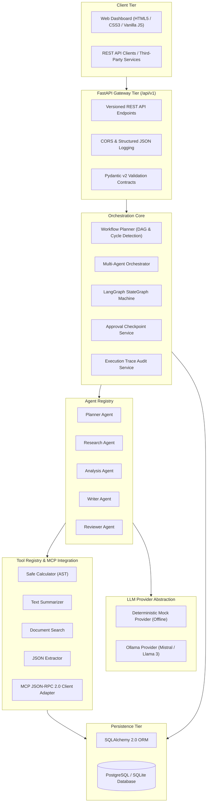

# AgentFlow AI — Intelligent Multi-Agent Workflow Orchestration Platform

[](https://www.python.org/)
[](https://fastapi.tiangolo.com/)
[](https://langchain-ai.github.io/langgraph/)
[](https://www.sqlalchemy.org/)
[](https://docs.pydantic.dev/)
[](https://opensource.org/licenses/MIT)
[]()

> **AgentFlow AI** is a modular, production-grade platform for designing, orchestrating, executing, and monitoring collaborative multi-agent AI workflows. It transforms high-level, unstructured objectives into deterministic subtasks executed across specialized agents, standardizes external tool calling with the **Model Context Protocol (MCP)**, enforces governance with **Human-in-the-Loop (HITL)** approval checkpoints, and provides full execution observability.

---

## Table of Contents

1. [Core Capabilities](#1-core-capabilities)
2. [Architecture Overview](#2-architecture-overview)
3. [Multi-Agent Workflow Pipeline](#3-multi-agent-workflow-pipeline)
4. [Technology Stack](#4-technology-stack)
5. [Directory Structure](#5-directory-structure)
6. [Specialized Agent Roles](#6-specialized-agent-roles)
7. [Tool Registry & Safe AST Evaluator](#7-tool-registry--safe-ast-evaluator)
8. [Model Context Protocol (MCP) Integration](#8-model-context-protocol-mcp-integration)
9. [Human-in-the-Loop (HITL) Checkpoints](#9-human-in-the-loop-hitl-checkpoints)
10. [REST API Reference](#10-rest-api-reference)
11. [Frontend Dashboard](#11-frontend-dashboard)
12. [Installation & Local Setup](#12-installation--local-setup)
13. [Running with Docker](#13-running-with-docker)
14. [Automated Testing & Results](#14-automated-testing--results)
15. [Security & Guardrails](#15-security--guardrails)
16. [Known Limitations & Future Improvements](#16-known-limitations--future-improvements)

---

## 1. Core Capabilities

- **Stateful Multi-Agent Orchestration**: Directed state graphs built on LangGraph managing shared, immutable execution state across steps.
- **Topological DAG Planning**: Decomposes user tasks into subtasks, detects dependency cycles, and plans parallel execution stages via Kahn's algorithm.
- **5 Specialized Agent Personas**: Planner, Researcher, Analyst, Writer, and Reviewer agents with dedicated system prompts, Pydantic v2 input/output contracts, and isolated error boundaries.
- **Model Context Protocol (MCP) Client Adapter**: Standardized JSON-RPC 2.0 tool discovery (`tools/list`) and invocation (`tools/call`) layer for distributed tool servers.
- **Safe Math Sandbox (Zero `eval`/`exec`)**: Safe AST evaluation for quantitative formulas and statistical metrics with zero remote code execution risk.
- **Human-in-the-Loop Approval Checkpoints**: Pauses workflow execution for plan approvals or sensitive actions; preserves serialized state and resumes cleanly.
- **Granular Execution Traces**: Detailed millisecond-precision event logs capturing agent transitions, tool parameters, durations, and retry counts.
- **Dual Storage Engine**: Zero-dependency SQLite for immediate offline local development and PostgreSQL for scalable enterprise deployment.
- **Modern Responsive Dashboard**: Single-page dark-mode web application (HTML5/CSS3/Vanilla JS) consuming backend REST APIs with live execution stepper animations.

---

## 2. Architecture Overview



---

## 3. Multi-Agent Workflow Pipeline

Example user task:
> *"Research enterprise AI trends and prepare a technical report."*

Execution pipeline flow:

```mermaid
sequenceDiagram
    autonumber
    actor User as Operator / Client
    participant API as FastAPI Gateway
    participant Orch as Multi-Agent Orchestrator
    participant Plan as Planner Agent
    participant Res as Research Agent
    participant Ana as Analysis Agent
    participant Wri as Writer Agent
    participant Rev as Reviewer Agent
    participant DB as SQLAlchemy / SQLite

    User->>API: POST /api/v1/workflows (Task Objective)
    API->>Plan: Deconstruct Task & Map Dependencies
    Plan-->>API: Validated Subtask Plan (DAG)
    API->>DB: Persist Workflow & WorkflowTasks (Status: DRAFT)
    API-->>User: Workflow Created (Plan Preview)

    User->>API: POST /api/v1/workflows/{id}/execute
    API->>Orch: Start LangGraph Execution
    Orch->>DB: Log [WORKFLOW_START] Trace

    rect rgb(20, 30, 50)
        Note over Orch,Res: Stage 1: Evidence Gathering
        Orch->>Res: Execute Research Subtask
        Res->>Res: Call DocumentSearchTool & SummarizerTool
        Res-->>Orch: Research Findings & Authoritative Sources
    end

    rect rgb(20, 30, 50)
        Note over Orch,Ana: Stage 2: Quantitative Analysis
        Orch->>Ana: Execute Analysis Subtask
        Ana->>Ana: Call Safe Calculator Tool (AST)
        Ana-->>Orch: Quantitative Metrics, Trade-offs & Risks
    end

    rect rgb(20, 30, 50)
        Note over Orch,Wri: Stage 3: Technical Drafting
        Orch->>Wri: Execute Writer Subtask
        Wri-->>Orch: Publication-Ready Markdown Report
    end

    rect rgb(20, 30, 50)
        Note over Orch,Rev: Stage 4: Quality & Compliance Audit
        Orch->>Rev: Audit Deliverable Against Rubric
        Rev-->>Orch: Score (100/100) & Verdict: APPROVED
    end

    Orch->>DB: Save Executions, Tool Invocations & [WORKFLOW_END] Trace
    Orch-->>API: Consolidated Deliverable
    API-->>User: Execution Result (Status: COMPLETED)
```



---

## 4. Technology Stack

| Layer | Technologies | Purpose |
|---|---|---|
| **Backend Framework** | Python 3.11+, FastAPI, Uvicorn | Async ASGI REST API server |
| **Data Contracts** | Pydantic v2, Pydantic-Settings | Strict request/response typing and config validation |
| **Orchestration** | LangGraph, LangChain Core | Cyclic state machines, conditional routing, checkpoints |
| **Tool Integration** | Model Context Protocol (MCP), Python AST | Standardized tool calling and safe mathematical evaluation |
| **Persistence** | SQLAlchemy 2.0, PostgreSQL, SQLite | Relational persistence with async session adapter |
| **AI Providers** | Ollama (Mistral / Llama 3), Deterministic Mock | Local LLM inference with 100% offline fallback |
| **Frontend** | HTML5, Modern CSS3, Vanilla JavaScript (ES6+) | Dark-mode single-page management dashboard |
| **Testing** | Pytest, Pytest-Asyncio, HTTPX | Automated test suite and integration test harness |
| **Infrastructure** | Docker, Docker Compose | Containerized multi-service deployment |

---

## 5. Directory Structure

```
agentflow-ai/
├── app/
│   ├── api/
│   │   └── v1/
│   │       ├── endpoints/
│   │       │   ├── agents.py           # GET /agents, GET /agents/{id}
│   │       │   ├── executions.py       # GET /executions, GET /executions/{id}
│   │       │   ├── health.py           # GET /health
│   │       │   ├── tools.py            # GET /tools, POST /tools/{id}/execute
│   │       │   └── workflows.py        # CRUD, execute, approve, reject, traces
│   │       └── api.py                  # API v1 aggregation router
│   ├── agents/
│   │   ├── base.py                     # BaseAgent abstract class & schemas
│   │   ├── registry.py                 # AgentRegistry singleton
│   │   ├── planner.py                  # Planner Agent (DAG task deconstruction)
│   │   ├── researcher.py               # Research Agent (evidence retrieval)
│   │   ├── analyst.py                  # Analysis Agent (quantitative evaluation)
│   │   ├── writer.py                   # Writer Agent (deliverable drafting)
│   │   └── reviewer.py                 # Reviewer Agent (quality & rubric audit)
│   ├── orchestration/
│   │   ├── graph.py                    # LangGraph StateGraph builder & routing
│   │   ├── orchestrator.py             # MultiAgentOrchestrator coordination engine
│   │   ├── state.py                    # WorkflowState TypedDict schema
│   │   └── workflow_planner.py         # Topological sorting & cycle detection
│   ├── tools/
│   │   ├── base.py                     # BaseTool abstract class & ToolResult
│   │   ├── registry.py                 # ToolRegistry singleton
│   │   ├── calculator.py               # Safe AST Math Evaluator (zero eval)
│   │   ├── summarizer.py               # Text Summarization Tool
│   │   ├── document_search.py          # Document Corpus Search Tool
│   │   └── json_extractor.py           # Structured JSON Extractor Tool
│   ├── mcp/
│   │   ├── schemas.py                  # JSON-RPC 2.0 MCP protocol schemas
│   │   ├── adapter.py                  # MCPToolAdapter wrapping MCP to BaseTool
│   │   └── manager.py                  # MCPConnectionManager & server lifecycle
│   ├── llm/
│   │   ├── base.py                     # BaseLLMProvider abstract interface
│   │   ├── mock.py                     # Deterministic Mock Provider (offline)
│   │   ├── ollama.py                   # Ollama local provider (Mistral/Llama)
│   │   └── factory.py                  # Provider factory
│   ├── approvals/
│   │   └── service.py                  # Human-in-the-Loop Approval Service
│   ├── tracing/
│   │   └── service.py                  # Execution Trace & Audit Service
│   ├── db/
│   │   ├── base.py                     # SQLAlchemy 2.0 DeclarativeBase
│   │   └── session.py                  # Async session adapter & engine
│   ├── models/                         # SQLAlchemy ORM Models
│   │   ├── agent.py, workflow.py, execution.py, tool.py, approval.py, trace.py
│   │   └── __init__.py
│   ├── schemas/                        # Pydantic v2 Validation Schemas
│   │   ├── agent.py, workflow.py, execution.py, tool.py, approval.py, trace.py
│   │   └── __init__.py
│   ├── services/
│   │   └── workflow_service.py         # Workflow business logic & orchestration
│   ├── core/
│   │   ├── exceptions.py               # Custom domain exceptions
│   │   └── logging.py                  # Structured JSON & console logger
│   ├── config.py                       # Pydantic Settings configuration
│   └── main.py                         # FastAPI app entrypoint & static mounts
├── frontend/
│   ├── index.html                      # Single-page dashboard interface
│   ├── styles.css                      # Modern dark-theme stylesheet
│   └── app.js                          # Vanilla JavaScript frontend controller
├── tests/
│   ├── conftest.py                     # Pytest fixtures & in-memory test DB
│   ├── test_agents.py                  # Agent lifecycle & execution tests
│   ├── test_workflow_planner.py        # Planning, cycle detection & DAG tests
│   ├── test_orchestrator.py            # LangGraph pipeline orchestration tests
│   ├── test_tools.py                   # Safe AST calculator & tool tests
│   ├── test_mcp_adapter.py             # MCP adapter & server discovery tests
│   ├── test_approvals.py               # HITL pause, approval & reject tests
│   ├── test_tracing.py                 # Execution trace audit logging tests
│   └── test_api.py                     # E2E integration tests for all 14 routes
├── sample-data/
│   ├── sample_workflows.json           # Sample workflow template payloads
│   └── documents/                      # Local knowledge corpus
│       ├── enterprise_ai_trends.txt
│       └── cloud_native_patterns.txt
├── scripts/
│   ├── seed_data.py                    # Database seeding utility
│   └── run_demo.py                     # End-to-end terminal demonstration
├── docs/                               # In-depth architectural documentation
│   ├── architecture.md
│   ├── agent-design.md
│   ├── orchestration-flow.md
│   ├── mcp-integration.md
│   ├── api-reference.md
│   └── security.md
├── .env.example                        # Environment template
├── .gitignore                          # Exclusions for secrets, venvs, databases
├── requirements.txt                    # Pinned production dependencies
├── pyproject.toml                      # Project metadata & build configuration
├── pytest.ini                          # Test configuration
├── Dockerfile                          # Multi-stage production container build
├── docker-compose.yml                  # Multi-service compose (API + Postgres)
├── README.md                           # Documentation
└── LICENSE                             # MIT License
```

---

## 6. Specialized Agent Roles

1. **Planner Agent (`planner-agent`)**:
   Deconstructs high-level objectives into granular subtasks, computes dependency graphs, and outputs structured execution blueprints.
2. **Research Agent (`research-agent`)**:
   Collects verifiable domain literature, cites sources, and invokes document retrieval and summarization tools.
3. **Analysis Agent (`analysis-agent`)**:
   Performs quantitative validation, runs mathematical formulas via isolated calculator tools, evaluates trade-offs, and scores risks.
4. **Writer Agent (`writer-agent`)**:
   Synthesizes planner criteria, research findings, and analytical data into an articulate, executive-ready technical deliverable in Markdown.
5. **Reviewer Agent (`reviewer-agent`)**:
   Conducts an objective quality and compliance audit against user criteria, scoring deliverables from 0 to 100 with an approval verdict.

---

## 7. Tool Registry & Safe AST Evaluator

All tools implement the `BaseTool` contract, declaring strict Pydantic v2 parameter models, sensitivity flags, and human approval requirements.

### Core Built-in Tools
- **Safe Calculator (`calculator`)**:
  Evaluates mathematical expressions safely using Python's Abstract Syntax Tree (`ast.parse`) node visitor. Whitelists basic arithmetic, power, square root, rounding, and statistical helpers. **Completely avoids `eval()` and `exec()`.**
- **Text Summarizer (`summarizer`)**:
  Produces concise executive summaries, sentence statistics, word reduction percentages, and bulleted takeaways.
- **Document Search (`document_search`)**:
  Queries local knowledge repositories and returns relevant document snippets with relevance scoring and citations.
- **Structured JSON Extractor (`json_extractor`)**:
  Extracts and repairs JSON blocks embedded within conversational prose or Markdown code fences.

---

## 8. Model Context Protocol (MCP) Integration

> **Supported Integration Level**: MCP JSON-RPC 2.0 Client Adapter Layer (Tool Discovery and Tool Invocations).

AgentFlow AI wraps external or in-memory MCP servers into native `BaseTool` instances via `MCPToolAdapter`.

- **Discovery (`tools/list`)**: Queries MCP servers for exposed tools and translates JSON Schema specifications into dynamic Pydantic models.
- **Invocation (`tools/call`)**: Packages agent parameters into standard JSON-RPC 2.0 envelopes and parses MCP text or JSON responses.
- **Server Lifecycle**: `MCPConnectionManager` tracks server health, handles connection dropouts gracefully, and registers tools into `ToolRegistry`.

---

## 9. Human-in-the-Loop (HITL) Checkpoints

For sensitive operations and plan verification:
1. Workflows configured with `requires_approval=True` automatically pause execution after DAG decomposition.
2. Execution state is persisted with status `PAUSED` and an `ApprovalRequestModel` is generated.
3. Operators inspect the pending request in the frontend dashboard or via `POST /api/v1/workflows/{id}/approve`.
4. Resumed workflows pick up directly from where they paused without re-executing completed subtasks.

---

## 10. REST API Reference

All routes are versioned under `/api/v1`.

### Health & Diagnostics
- `GET /api/v1/health` — Returns status of Database, LLM provider, agents, tools, and MCP servers.

### Agent Registry
- `GET /api/v1/agents` — List all registered agents with capabilities and status.
- `GET /api/v1/agents/{agent_id}` — Get single agent specification, system prompt, and schemas.

### Workflows
- `POST /api/v1/workflows` — Decompose task and generate workflow plan (`201 Created`).
- `GET /api/v1/workflows` — List workflows with pagination (`skip`, `limit`).
- `GET /api/v1/workflows/{workflow_id}` — Get workflow details, subtasks, and executions.
- `POST /api/v1/workflows/{workflow_id}/execute` — Trigger LangGraph multi-agent execution.
- `POST /api/v1/workflows/{workflow_id}/approve` — Approve pending plan and resume execution.
- `POST /api/v1/workflows/{workflow_id}/reject` — Reject workflow plan with reviewer notes.
- `GET /api/v1/workflows/{workflow_id}/traces` — Retrieve chronological audit traces.

### Tools & Sandbox
- `GET /api/v1/tools` — List registered tools (built-in and MCP).
- `POST /api/v1/tools/{tool_id}/execute` — Directly test a tool with JSON parameters.

### Execution History
- `GET /api/v1/executions` — List historical execution runs.
- `GET /api/v1/executions/{execution_id}` — Inspect execution details, agent outputs, and tool calls.

---

## 11. Frontend Dashboard

The dashboard is served directly by the FastAPI backend at `http://localhost:8000/`:

- **Overview Tab**: Key performance indicators, system diagnostics, and recent workflow history.
- **Workflow Studio**: Interactive workflow planner with synthetic example templates and DAG visualizer.
- **Live Execution Monitor**: Multi-stage pipeline stepper (Planner -> Researcher -> Analyst -> Writer -> Reviewer -> Orchestrator) with active stage pulses, live Markdown deliverable rendering, quality score badges, and real-time trace events.
- **Agent Registry**: Detailed cards with system prompts and capability tags for each agent.
- **Tool Sandbox**: Interactive tool tester allowing operators to enter JSON parameters and verify tool outputs.
- **Approvals Queue**: Human-in-the-Loop decision panel with one-click Approve/Reject actions.
- **History & Traces**: Full historical execution audit table with drill-down modal views.

---

## 12. Installation & Local Setup

### Prerequisites
- Python 3.11+
- Git

### 1. Clone & Set Up Virtual Environment
```bash
cd agentflow-ai
python -m venv .venv

# On Linux/macOS:
source .venv/bin/activate
# On Windows PowerShell:
.\.venv\Scripts\Activate.ps1
```

### 2. Install Dependencies
```bash
pip install -r requirements.txt
```

### 3. Configure Environment
```bash
cp .env.example .env
```
*(Default settings use SQLite and the Deterministic Mock LLM Provider for 100% offline functionality).*

### 4. Seed Database & Run Terminal Demo
```bash
# Seed initial agents, tools, and sample workflows:
python scripts/seed_data.py

# Run an end-to-end multi-agent demonstration:
python scripts/run_demo.py
```

### 5. Start the Web Platform
```bash
uvicorn app.main:app --reload --host 0.0.0.0 --port 8000
```
Open `http://localhost:8000/` in your browser to access the interactive dashboard, or `http://localhost:8000/docs` for the interactive Swagger API docs.

---

## 13. Running with Docker

### Using Docker Compose (API + PostgreSQL)
```bash
cd agentflow-ai
docker-compose up --build
```
This provisions:
- `agentflow-api`: FastAPI backend and frontend dashboard on port `8000`.
- `agentflow-postgres`: PostgreSQL 16 database with health check on port `5432`.

Access the dashboard at `http://localhost:8000/`.

---

## 14. Automated Testing & Results

The project includes automated tests covering agents, DAG planning, topological sorting, cycle detection, LangGraph orchestration, safe AST calculation, MCP adapter wrapping, approvals, audit traces, and all REST endpoints.

Run tests using pytest:
```bash
pytest tests -v
```

### Actual Test Execution Output
```
============================= test session starts =============================
platform win32 -- Python 3.11.17, pytest-9.2.0, pluggy-1.7.0
plugins: anyio-4.16.0, langsmith-0.14.17, asyncio-1.4.1.post1
asyncio: mode=Mode.AUTO, asyncio_default_fixture_loop_scope=function
collected 33 items

tests/test_agents.py::test_agent_registry_lifecycle PASSED              [  3%]
tests/test_agents.py::test_planner_agent_execution PASSED               [  6%]
tests/test_agents.py::test_research_agent_execution PASSED              [  9%]
tests/test_agents.py::test_analyst_agent_execution PASSED               [ 12%]
tests/test_agents.py::test_writer_agent_execution PASSED                [ 15%]
tests/test_agents.py::test_reviewer_agent_execution PASSED              [ 18%]
tests/test_agents.py::test_agent_input_validation_error PASSED          [ 21%]
tests/test_api.py::test_api_health_endpoint PASSED                      [ 24%]
tests/test_api.py::test_api_agents_endpoints PASSED                     [ 27%]
tests/test_api.py::test_api_tools_endpoints PASSED                      [ 30%]
tests/test_api.py::test_api_workflows_lifecycle PASSED                  [ 33%]
tests/test_api.py::test_api_workflow_approval_and_rejection PASSED     [ 36%]
tests/test_api.py::test_api_validation_errors PASSED                    [ 39%]
tests/test_approvals.py::test_approval_lifecycle PASSED                 [ 42%]
tests/test_approvals.py::test_workflow_pause_and_approval_resume PASSED [ 45%]
tests/test_approvals.py::test_workflow_rejection PASSED                 [ 48%]
tests/test_mcp_adapter.py::test_mcp_tool_adapter_wrapping_and_invocation PASSED [ 51%]
tests/test_mcp_adapter.py::test_mcp_manager_discovery_and_sync PASSED   [ 54%]
tests/test_mcp_adapter.py::test_mcp_manager_disconnected_server_error PASSED [ 57%]
tests/test_orchestrator.py::test_full_pipeline_orchestration PASSED     [ 60%]
tests/test_orchestrator.py::test_orchestrator_handles_nonexistent_workflow PASSED [ 63%]
tests/test_tools.py::test_calculator_safe_evaluation PASSED             [ 66%]
tests/test_tools.py::test_calculator_security_boundaries PASSED         [ 69%]
tests/test_tools.py::test_summarizer_tool PASSED                        [ 72%]
tests/test_tools.py::test_document_search_tool PASSED                   [ 75%]
tests/test_tools.py::test_structured_json_extractor_tool PASSED         [ 78%]
tests/test_tools.py::test_tool_registry_operations PASSED               [ 81%]
tests/test_tracing.py::test_trace_creation_and_retrieval PASSED         [ 84%]
tests/test_tracing.py::test_end_to_end_traces_generation PASSED         [ 87%]
tests/test_workflow_planner.py::test_create_valid_plan PASSED           [ 90%]
tests/test_workflow_planner.py::test_dependency_validation_missing_task PASSED [ 93%]
tests/test_workflow_planner.py::test_cycle_detection PASSED             [ 96%]
tests/test_workflow_planner.py::test_topological_sorting_and_parallel_stages PASSED [100%]

============================= 33 passed in 0.51s ==============================
```
**Test Summary: 33 passed, 0 failed, 100% success rate.**

---

## 15. Security & Guardrails

- **Safe Tool Execution**: Calculator uses an isolated AST visitor whitelisting strictly arithmetic and approved math functions. Dynamic evaluation (`eval()`, `exec()`, `os.system`) is completely absent from the codebase.
- **Strict Schema Enforcement**: Pydantic v2 validates inputs and outputs across all API boundaries and tool calls.
- **Fail-Safe Approvals**: Sensitive tools and workflows requiring review cannot execute without signed approval records.
- **Secret Hygiene**: Environment variables are managed via `.env` files and `.gitignore`.

---

## 16. Known Limitations & Future Improvements

### Known Limitations
1. **MCP Scope**: Current implementation provides client-side tool discovery (`tools/list`) and invocation (`tools/call`). Prompt template negotiation and dynamic resource subscriptions are not yet implemented.
2. **Local Vector Embeddings**: Document search uses an in-memory keyword relevance and scoring model. For massive document libraries, integration with pgvector or external vector indices is recommended.
3. **Distributed Locks**: Multi-worker deployments running concurrent executions of the same workflow record currently rely on database transactions rather than Redis distributed locks.

### Future Improvements
- **WebSocket Streaming**: Stream agent thoughts and intermediate tokens directly to the frontend timeline.
- **pgvector Integration**: Native semantic vector similarity search for document corpora.
- **Full MCP Server Role**: Enable AgentFlow AI to act both as an MCP client and an upstream MCP server exposing agents as tools.
- **Dynamic Human Feedback Loops**: Allow operators to inject revised notes into an active workflow state midway through execution.

---

## License

This project is licensed under the MIT License — see the [LICENSE](LICENSE) file for details.

