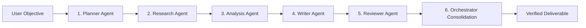

# Specialized Agent Design

AgentFlow AI implements an agentic architecture centered on specialized collaboration rather than monolithic generalist prompts.

---

## 1. The 5 Specialized Agent Roles

### A. Planner Agent (`planner-agent`)
- **Primary Responsibility**: Deconstructs high-level user tasks into ordered subtasks, identifies data dependencies, assigns agents, and creates an execution plan.
- **System Prompt**: Enforces structured JSON output matching `PlannerOutput` schema; identifies pipeline requirements for research, quantitative analysis, report drafting, and review.
- **Input Schema**: `PlannerInput(task: str, parameters: dict)`
- **Output Schema**: `PlannerOutput(summary: str, strategic_objective: str, tasks: list[SubTaskPlanItem], estimated_duration_seconds: int)`
- **Tools**: None directly required; relies on structured LLM reasoning and DAG topological sort.

### B. Research Agent (`research-agent`)
- **Primary Responsibility**: Gathers empirical evidence, technical specifications, and domain literature relevant to the plan.
- **System Prompt**: Enforces factual grounding, citation generation, and synthesis of raw search snippets into structured findings.
- **Input Schema**: `ResearchInput(query: str, context_notes: str | None)`
- **Output Schema**: `ResearchOutput(summary: str, findings: list[ResearchFinding], sources_consulted: list[str], raw_evidence_count: int)`
- **Tools Utilized**: `document_search` (corpus retrieval), `summarizer` (extracting core passages).

### C. Analysis Agent (`analysis-agent`)
- **Primary Responsibility**: Conducts quantitative assessments, computes metrics, evaluates trade-offs, and identifies technical risks.
- **System Prompt**: Focuses on numerical rigor, risk mitigation, and strategic recommendations.
- **Input Schema**: `AnalysisInput(research_summary: str, findings: list[dict], parameters: dict)`
- **Output Schema**: `AnalysisOutput(summary: str, quantitative_metrics: dict, strategic_insights: list[str], risks: list[RiskAssessment], recommendation: str)`
- **Tools Utilized**: `calculator` (safe AST evaluation of formulas, percentages, statistical metrics).

### D. Writer Agent (`writer-agent`)
- **Primary Responsibility**: Synthesizes the planner outline, research evidence, and analytical insights into an articulate, publication-ready Markdown deliverable.
- **System Prompt**: Mandates clear heading hierarchies, executive summaries, quantitative data tables, and actionable recommendations.
- **Input Schema**: `WriterInput(title: str | None, research_summary: str, analysis_insights: list[str], metrics: dict, original_task: str)`
- **Output Schema**: `WriterOutput(title: str, summary: str, markdown_content: str, sections: list[ReportSection], word_count: int)`
- **Tools Utilized**: `summarizer` (abstract generation), `json_extractor` (formatting data).

### E. Reviewer Agent (`reviewer-agent`)
- **Primary Responsibility**: Performs objective quality auditing on drafted deliverables against original requirements.
- **System Prompt**: Evaluates completeness, consistency, clarity, and safety; computes a rubric score between 0 and 100; renders verdict (`APPROVED` or `REVISION_REQUIRED`).
- **Input Schema**: `ReviewerInput(original_task: str, document_content: str, evaluation_criteria: list[str] | None)`
- **Output Schema**: `ReviewerOutput(summary: str, score: int, verdict: str, audit_findings: list[AuditFinding], recommendations: list[str], is_acceptable: bool)`
- **Tools Utilized**: Audit heuristic scoring rules and LLM evaluation.

---

## 2. Agent Execution Contract

Every specialized agent inherits from `BaseAgent` and guarantees:
1. **Schema Validation**: Automatic input validation against declared Pydantic models before execution.
2. **Error Isolation**: Failures in agent logic or tool calling are trapped, returning structured `AgentExecutionResult` models without crashing the orchestrator process.
3. **Trace Instrumentation**: Execution duration, input summaries, output summaries, and tool invocation metadata are captured for persistence.
4. **Tool Call Audit**: All invoked tools append standardized call records to `tool_calls`.

