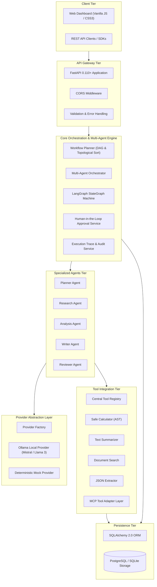

# AgentFlow AI — System Architecture

## 1. Executive Architecture Overview

**AgentFlow AI** is a modular platform for designing, orchestrating, executing, and monitoring collaborative AI agent workflows. It translates complex, unstructured objectives into discrete subtasks coordinated via directed state graphs, standardizes tool invocations using the Model Context Protocol (MCP), and enforces enterprise governance through Human-in-the-Loop (HITL) checkpoints.

---

## 2. Component Breakdown

### A. Client Tier
- **Frontend Dashboard**: Responsive single-page interface implemented with semantic HTML5, modern CSS3, and vanilla JavaScript using the native Fetch API.
- **REST Consumers**: OpenAPI-compliant client applications consuming versioned JSON endpoints under `/api/v1`.

### B. Gateway Tier
- **FastAPI Core**: Handles request routing, parameter validation using Pydantic v2 schemas, lifespan database setup, and structured JSON error responses.

### C. Orchestration Tier
- **Workflow Planner**: Analyzes user tasks, performs Directed Acyclic Graph (DAG) cycle detection, and computes topological execution orders.
- **LangGraph StateGraph**: Maintains a shared immutable state across pipeline steps (`WorkflowState`), routing transitions conditionally based on approval flags and audit scores.
- **Multi-Agent Orchestrator**: Coordinates node transitions, handles transient retries with configurable limits, and persists execution metadata.

### D. Specialized Agents Tier
Five dedicated autonomous agent implementations with isolated system prompts, schemas, and execution boundaries:
1. `PlannerAgent`: Decomposes tasks into structured subtasks.
2. `ResearchAgent`: Gathers factual evidence and citations via document search tools.
3. `AnalysisAgent`: Computes quantitative metrics and evaluates risks using AST calculators.
4. `WriterAgent`: Synthesizes findings into comprehensive technical deliverables.
5. `ReviewerAgent`: Audits deliverables against requirements, assigning quality scores (0-100).

### E. Tool & MCP Integration Tier
- **Tool Registry**: Manages discovery, schema validation, and execution for native and external tools.
- **MCP Client Adapter**: Implements JSON-RPC 2.0 communication to discover remote tools from MCP servers and map them into the platform's unified tool calling interface.

### F. Persistence Tier
- **SQLAlchemy 2.0**: Relational persistence supporting PostgreSQL in production and SQLite for local development and offline testing.
- **Audit Models**: Workflows, Subtasks, Executions, Agent Executions, Tool Invocations, Approval Requests, and Fine-Grained Execution Traces.

