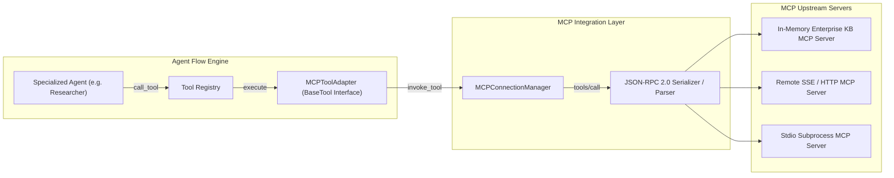

# Model Context Protocol (MCP) Integration

## 1. Supported Integration Level

> **Integration Level Notice**:
> AgentFlow AI provides a **Model Context Protocol (MCP) JSON-RPC 2.0 Client Adapter Layer**.
> It supports **Tool Discovery (`tools/list`)** and **Tool Invocation (`tools/call`)** interfaces according to the Model Context Protocol specification. It does **not** claim full implementation of all MCP server host features (such as dynamic resource subscription trees or prompt template negotiation).

---

## 2. MCP Integration Architecture

AgentFlow AI wraps external or simulated MCP servers into native `BaseTool` instances, allowing agents to discover and invoke MCP tools transparently without bespoke vendor glue code.



---

## 3. Protocol Specifications

### A. Tool Discovery (`tools/list`)
Client sends a standard JSON-RPC 2.0 request:
```json
{
  "jsonrpc": "2.0",
  "id": 1,
  "method": "tools/list",
  "params": {}
}
```
The server returns tool definitions conforming to `MCPToolDefinition`:
```json
{
  "jsonrpc": "2.0",
  "id": 1,
  "result": {
    "tools": [
      {
        "name": "query_knowledge_base",
        "description": "Query enterprise policy index",
        "inputSchema": {
          "type": "object",
          "properties": {
            "query": { "type": "string" },
            "department": { "type": "string" }
          },
          "required": ["query"]
        }
      }
    ]
  }
}
```

### B. Tool Invocation (`tools/call`)
When an agent invokes the tool:
```json
{
  "jsonrpc": "2.0",
  "id": 2,
  "method": "tools/call",
  "params": {
    "name": "query_knowledge_base",
    "arguments": {
      "query": "cloud security policy",
      "department": "compliance"
    }
  }
}
```
The server responds with structured content:
```json
{
  "jsonrpc": "2.0",
  "id": 2,
  "result": {
    "content": [
      {
        "type": "text",
        "text": "{\"status\": \"found\", \"policy_code\": \"POL-2026-SEC\"}"
      }
    ],
    "isError": false
  }
}
```

---

## 4. Error Handling & Connection Lifecycle

1. **Server Discovery Resilience**: If an upstream MCP server is unreachable, `MCPConnectionManager` logs a diagnostic warning and marks `is_connected = False` without halting the core platform.
2. **Schema Adaptation**: `MCPToolAdapter` dynamically converts the server's `inputSchema` into an on-the-fly Pydantic model (`create_model`), verifying input types before sending requests over the wire.
3. **Graceful Degradation**: If an MCP tool fails or times out, the error is encapsulated in `ToolResult(status="FAILED", error=...)`, allowing the calling agent to catch the error or try alternative sources.

