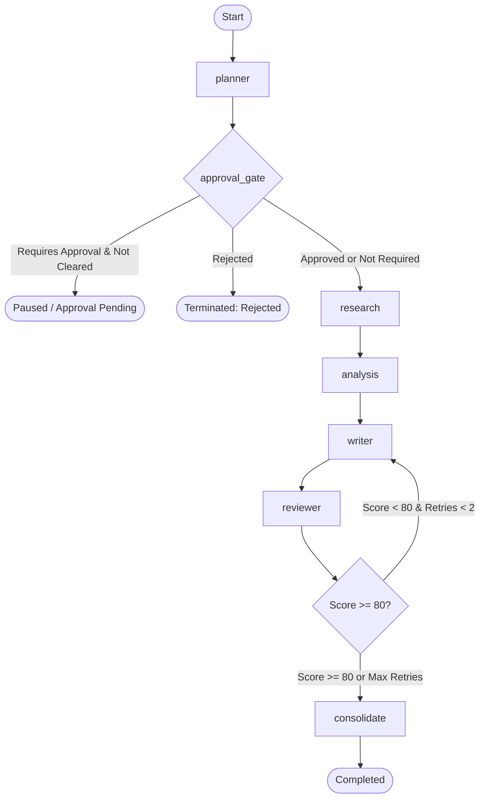

# LangGraph Orchestration Flow & State Management

AgentFlow AI utilizes **LangGraph** to model multi-agent workflows as stateful, cyclic directed graphs with explicit conditional transitions and Human-in-the-Loop checkpoints.



---

## 1. Global Shared State (`WorkflowState`)

All nodes in the graph communicate via a typed dictionary state:

```python
class WorkflowState(TypedDict, total=False):
    workflow_id: str
    execution_id: str
    original_task: str
    plan: Dict[str, Any]
    current_step: str
    completed_steps: List[str]
    step_results: Dict[str, Any]          # e.g. {"research": ..., "analysis": ..., "writer": ..., "reviewer": ...}
    agent_outputs: Dict[str, Any]         # {"research-agent": "summary...", ...}
    tool_invocations: List[Dict[str, Any]]# Record of every tool call made
    requires_approval: bool
    approval_status: str                  # "NONE" | "PENDING" | "APPROVED" | "REJECTED"
    approval_id: Optional[str]
    errors: List[str]
    retry_counts: Dict[str, int]
    final_output: Dict[str, Any]
    status: str                           # "PENDING" | "RUNNING" | "COMPLETED" | "PAUSED" | "FAILED"
```

---

## 2. Conditional Routing & Feedback Loops

### A. Approval Checkpoint Routing
- The `approval_gate` conditional edge inspects `state["requires_approval"]` and `state["approval_status"]`.
- If approval is mandatory and unresolved, the graph transitions to `END`, setting state status to `PAUSED` and creating an `ApprovalRequestModel` in the database.
- Upon calling `/api/v1/workflows/{id}/approve`, the orchestrator marks approval status as `APPROVED` and resumes graph execution starting directly from the research stage.

### B. Quality Review Feedback Loop
- The `route_after_review` conditional edge checks `state["step_results"]["reviewer"]["score"]`.
- If `score < 80` and the writer retry count has not exceeded 2, the edge loops back to `writer` with reviewer critiques stored in state.
- Once quality threshold is met (or max retries reached), it routes to `consolidate` to build final artifacts.

---

## 3. Parallel Execution via Topological Sorting

For custom subtasks beyond the reference sequential pipeline, the `WorkflowPlanner` computes parallel execution stages using Kahn's algorithm:

```python
tasks = [
    {"task_id": "T1", "dependencies": []},
    {"task_id": "T2", "dependencies": ["T1"]},
    {"task_id": "T3", "dependencies": ["T1"]}, # T2 and T3 have disjoint dependencies
    {"task_id": "T4", "dependencies": ["T2", "T3"]},
]
# Resulting execution stages:
# Stage 0: ["T1"]
# Stage 1: ["T2", "T3"]  <-- Can execute concurrently via asyncio.gather
# Stage 2: ["T4"]
```
Cycle detection runs via Depth-First Search with 3-color vertex marking, preventing infinite loops prior to execution.

